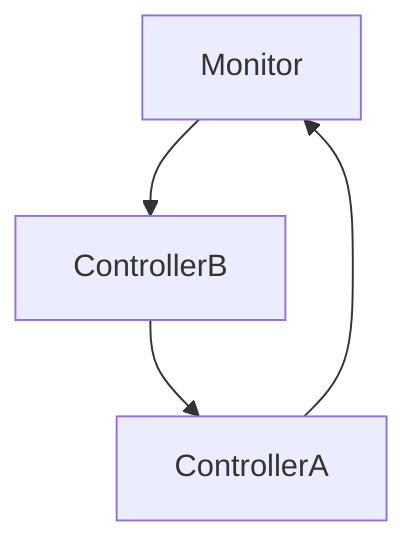

# Microcontrollers

# This README is outdated -> currently migrating to Wiki

> [!CAUTION] Microcontrollers is still in prerelease. Please report bugs when found!

## What is Microcontroller style programming

**Controller** style programming is a component based programming style, 
where you define Controllers with logic to be executed.
These **controllers** can pass eatchother data or a video signal.



In this Example we have **ControllerB**, taking the touch data from the **Monitor** 
and passing its output to **ControllerA**, to be displayed on the **Monitor**.

#### This makes the microcontroller aproach very suitable for testing multi device Applications.

Code example:
```
Code/Controllers_Console_tester
```

## How to set it up

#### 1. Download the lastest release.
####
#### 2. Unzip the Microcontroller.zip file and copy it into your Library folder.
####
#### 3. Create a new **C# / .Net 10 Console project** *[This example will use Visual Studio]*
####
#### 4. Download Skiasharp via:
```CMD 
dotnet add package SkiaSharp --version 4.148.0 
```
####
#### 5. Change TargetFramework and UseForms
```XML
Replace
<TargetFramework>net10.0</TargetFramework>

With
<TargetFramework>net10.0-windows</TargetFramework>
<UseWindowsForms>true</UseWindowsForms>
```
####
#### 6. Add the microcontroller library
> Microcontrollers.dll

#### 7. Initialize the Simulation
```csharp
// Creates new Simulation-window with size 500x500px
SimulationSpace simulation = new SimulationSpace(500, 500);

// Code here

await simulation.RunControllers(new CancellationToken());
```

#### 8. Initialize the Scematiceditor
When running the Microcontrollers a JsonDiagram path is shown in the console.
This path is needed for **ScematicEditor.exe** to run.
On first start of **ScematicEditor.exe** the file **JSONDiagramPath.txt** is generated, 
this file must contain the path to your JsonDiagram file.

## Documentation
> [!CAUTION] WIP.

#### SimulationSpace
```csharp
// Creates new Simulation-window with size 500x500px
SimulationSpace simulation = new SimulationSpace(500, 500);

// Adds Microcontroller to simulationque >> class has to inherit from IMicrocontroller
simulation.AddMicrocontroller("Controller1",new MyController1());

// Adds a MonitorComponent with a resolution of 64x64px with a real pixel size of 250x250px
simulation.addMonitor("MainVideoOut", new Size(64, 64), new Size(250, 250));

// Adds a LogicComponent >> class has to inherit from ILogicGate >> ID has to be unique
simulation.addLogicGate(1, new AndGate());

// Run the simulation >> should be last command in program
await simulation.RunControllers(new CancellationToken());
```

#### Microcontrollers
```csharp
// basic setup
internal class MyController1 : IMicrocontroller
{
    public void Execute(Controller_Input Input, Controller_Output Output, ControllerGraphics Screen)
    {
        
    }
}
// Code inside of Execute will run every tick.
// Input contains all data beeing funneled into the input composite port.
// Output lets you funnel data out of the Microcontroller.
// Screen is used to write to the screen buffer.
```
